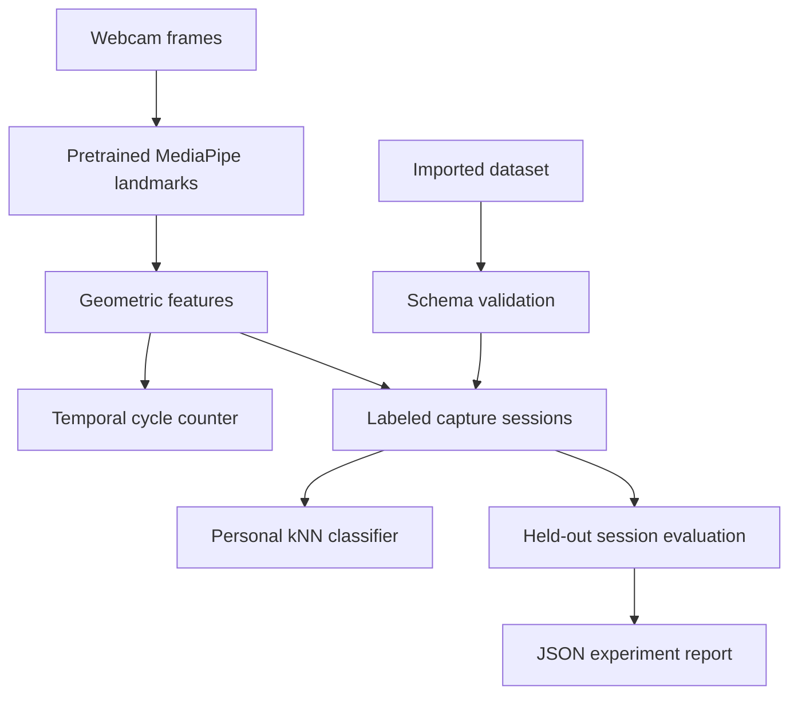

# Architecture and design decisions

## Module boundaries

| Module | Responsibility | Side effects |
| --- | --- | --- |
| `dist/core.js` | Geometry, synthetic hand, counter, classifiers, grouped evaluation | None |
| `dist/dataset.js` | Versioned dataset validation and report documents | Report timestamps only |
| `dist/app.js` | Camera lifecycle, rendering, collection, import/export | Camera permission; explicit downloads |
| `scripts/benchmark.mjs` | Evaluate exported CSV | File read; JSON to stdout |
| `scripts/evaluate-json.mjs` | Validate and evaluate saved JSON | File read; report to stdout |
| `scripts/check.mjs` | Syntax and UI-reference checks | Reads source; launches Node syntax checks |

## Why these choices

**Buildless browser app:** makes deployment and inspection straightforward. There is no server-side patient database, account system or application inference bill. External model files still need an internet connection.

**Handcrafted geometric features:** six understandable values provide an inspectable baseline for a small dataset. They sacrifice expressive power and cannot capture all movement dynamics.

**kNN:** supports immediate learning from a few examples without claiming a newly trained deep landmark network. It is sensitive to the collected examples and chooses a known class by default. Release 0.3 adds optional distance rejection calibrated on a held-out session. k=5 is fixed, not tuned on the test set.

**Session holdout:** prevents adjacent frames from one capture session appearing on both sides of the split. It does not automatically guarantee subject independence or remove all bias.

**Versioned JSON:** preserves provenance, labels and group boundaries. Import is bounded by file size and sample count; unknown labels and invalid numbers are rejected before UI or evaluation use.

## State and lifecycle

A source change releases existing camera tracks and clears the motion session and calibration. Dataset examples persist in tab memory until cleared or reloaded. Imported datasets explicitly replace previous examples. New recording-session IDs skip IDs already present after import.

Tracking loss interrupts the repetition state machine. The model is loaded lazily when camera use is requested. Failed camera startup reports an error and offers the independent simulation path. Page teardown releases camera tracks.

## Scaling limits

kNN inference computes distances to all examples. Held-out evaluation repeats neighbor search and sorting and is approximately quadratic in sample count, with an additional sorting factor. The application caps the dataset at 3,000 examples. Main-thread inference and evaluation can stall slow devices. Moving these operations into workers and benchmarking larger datasets are proposed work, not implemented capabilities.

## Research edition 0.3

`dist/research.js` records real camera inference attempts and condition metadata. `research/` contains a separate PyTorch public-marker benchmark, future camera benchmark, movement analysis and serial glove comparison. The public 18-feature MLP is not deployed in the six-feature browser classifier. See `RESEARCH_PROTOCOL.md` and the root README for data provenance and measured versus pending components.
