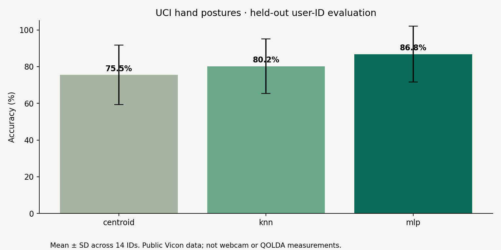
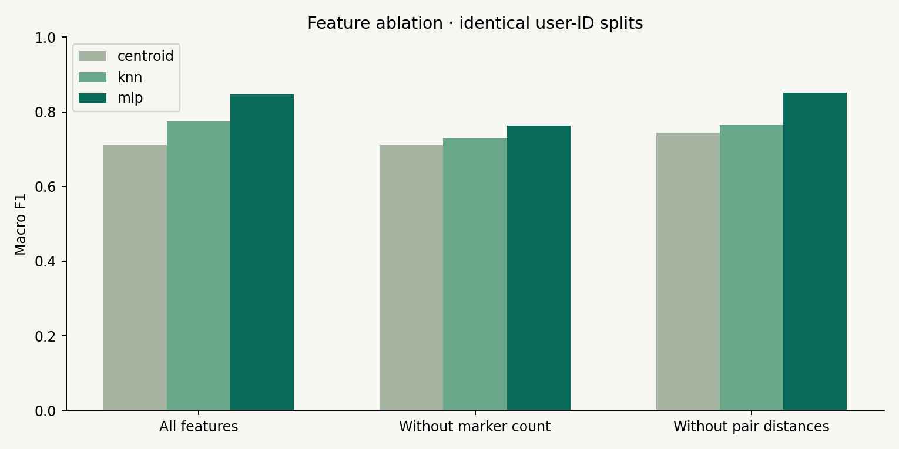

# QOLDA Vision — Hand Motion Research Lab

**A trained hand-posture benchmark, a browser motion lab, and tools for a future camera–glove agreement study.**

## Measured result: public motion-capture data

| Model | Mean held-user-ID accuracy ± SD | Macro F1 |
|---|---:|---:|
| Nearest centroid | 75.53% ± 16.21 pp | 0.712 |
| kNN, k=5 | 80.21% ± 14.87 pp | 0.774 |
| PyTorch MLP | **86.83% ± 15.28 pp** | **0.847** |



Actual training and evaluation on 5,050 sampled observations from [UCI Motion Capture Hand Postures](https://doi.org/10.24432/C5TG86), with 14 held-user-ID folds, identical splits and training-only standardization. These are **Vicon marker results, not webcam accuracy or QOLDA glove validation**. The source describes 12 users; its CSV contains 14 IDs. That discrepancy is unresolved, so this project does not claim 14 verified participants or original recruitment. SD is between-ID variation, not a confidence interval. One seed; fixed hyperparameters.

[Three-page report](docs/QOLDA_Research_Report.pdf) · [Results and ablations](research/results/TABLES.md) · [Colab notebook](QOLDA_Research_Colab.ipynb) · [60-second walkthrough](docs/assets/walkthrough-60s.mp4) · [Study protocol](docs/RESEARCH_PROTOCOL.md)

The walkthrough combines a **labeled synthetic hand animation** with measured public-data results. It is not a webcam recording or footage of a study.

## What release 0.3 contains

| Component | Evidence / status |
|---|---|
| PyTorch MLP vs kNN and centroid | Trained; per-fold weights, predictions, sample indices and split manifests included |
| Feature ablations | Measured on public data: remove marker count or pair-distance descriptors |
| Unknown-class rejection | Measured class-5 holdout experiment; optional separately calibrated browser rejection |
| Reliability | Measured synthetic marker-dropout stress test; real camera failure/jitter recorder and condition plots supplied |
| Movement quality | Amplitude, speed, RMS jerk and cycle variability implementation; correctness tests, no clinical validation |
| Camera–glove comparison | Receipt-time alignment, MAE/RMSE/bias/correlation tools; **hardware recordings pending** |
| New multi-person webcam study | Capture UI and participant-held-out runner supplied; **no new participants recruited** |
| World vs screen / six-feature / calibration ablations | Runner supplied for actual camera recordings; no invented results |

## Reproduce the measured experiment

Use Python 3.12 in a virtual environment. For a CPU-only PyTorch installation, install torch using its official CPU wheel index before installing the remaining requirements if needed.

```sh
python -m pip install -r research/requirements.txt
python research/benchmark.py
python research/plot_results.py
python -m unittest discover -s research -p 'test_*.py'
```

The benchmark downloads the attributed public dataset. Raw data is excluded from the repository. It uses up to 75 rows per class per user ID, seed 42, and 50 MLP epochs. Runtime depends on the computer. Results overwrite `research/results/`; copy that directory first to retain the supplied run. The source CSV SHA-256 and selected zero-based indices after dummy-row removal are recorded.

Alternatively, upload `QOLDA_Research_Colab.ipynb` into [Google Colab](https://colab.research.google.com/) and select **Runtime → Run all**. Its code is self-contained; no repository-name placeholder needs editing. Internet is needed for packages/data. The notebook records runtime versions; exact dependency pins are supplied locally. The packaged scripts were executed; a hosted Colab session was not independently tested.

### Benchmark method

Public markers are unordered and do not identify individual fingers. We use **18 permutation-invariant point-cloud features**, not the browser's six anatomical features. One ID is test, the next cyclic ID is validation, all others train. The same split applies to all models and ablations. An 18→64→32→5 ReLU MLP uses Adam, learning rate 0.001, weight decay 0.0001, batch size 128. Validation does not select epochs. Macro F1 includes all five labels even when a test ID lacks a class.

Removing marker count lowers MLP accuracy to **80.09%**; removing pair distances gives **87.25%**. More features do not always help. These exploratory comparisons are not an independently validated model-selection result. The MLP weights are for this public-data representation and **are not loaded into the browser**.

For open-set evaluation, class 5 is absent from training and calibration. The threshold is the 95th percentile of known validation kNN distances. Unknown recall is **57.44%**, known false rejection **11.25%**, AUROC **0.937** (averages over eligible folds). Good AUROC does not guarantee a good threshold: rejection remains imperfect. Missing metrics are null when a fold has no unknown examples.



## Run the browser lab

Double-click `START_WINDOWS.bat`, or from the project root:

```sh
python -m http.server 8000 --directory dist
```

Open **http://localhost:8000** and keep the terminal running. Use localhost or HTTPS. No npm install or API key is needed. Camera mode downloads Google's pretrained MediaPipe assets; internet access and camera permission are required. Simulation runs without a camera and is explicitly labeled.

- **Motion studio:** 21 landmarks, finger-extension proxies, personal calibration, dwell/hysteresis cycle counter and CSV export.
- **Gesture learning:** record labeled camera examples across sessions; personal kNN vs centroid; leave-one-session-out evaluation; dataset JSON import/export.
- **Unknown rejection:** reserve the last capture session to calibrate a distance threshold. New examples invalidate that calibration. This threshold has not been validated on real webcam data here.
- **Method → Research capture:** enable the camera first, specify anonymous participant/session and condition metadata, record a task, then export JSON. Every observed inference attempt is logged, including missing-hand frames. No images or names are stored. Start-new replaces the in-memory recording; export first.

Browser models use five extension descriptors plus normalized thumb–index separation. Extension is the mean of two internal joint angles divided by 180. This is a geometric proxy, not a clinical joint angle. World landmarks are preferred; screen landmarks are retained for paired comparisons. The open/close counter uses thresholds 0.75/0.25, 180-ms dwell and a 400-ms tracking-loss reset. MediaPipe perception is a [third-party pretrained component](https://ai.google.dev/edge/mediapipe/solutions/vision/hand_landmarker/web_js), not a neural network trained by this project.

## Camera, glove and movement experiments

See [the collection and synchronization protocol](docs/RESEARCH_PROTOCOL.md) for the exact contracts and commands. Glove support expects normalized named sensor readings and requires an adapter for the actual firmware. Comparing normalized proxies is not equivalent to measuring error in degrees. Clinical angles require joint-specific physical calibration and reference measurements.

```sh
python research/analysis.py captures/*.json
python research/condition_plots.py research/results/capture-analysis.json
python research/camera_benchmark.py captures/*.json
python research/glove_capture.py --port COM3 --seconds 60 --output glove.json
python research/compare_glove.py camera.json glove.json
```

No camera/glove agreement values, clinical outcomes, real lighting failure rates, or independently recruited participant counts are supplied. The UCI data has no usable timeline for this implementation, so no temporal or rehabilitation metrics are inferred from it.

## Verification and repository map

```sh
npm run check
npm test
python -m unittest discover -s research -p 'test_*.py'
```

[Validation record](docs/VALIDATION.md) · [Model card](docs/MODEL_CARD.md) · [Architecture](docs/ARCHITECTURE.md) · [Dataset contract](docs/DATASET_CARD.md)

| Path | Purpose |
|---|---|
| `dist/` | Buildless browser app |
| `research/benchmark.py` | Public-data training, evaluation, ablation and rejection |
| `research/results/` | Measured results and held-ID MLP checkpoints |
| `research/camera_benchmark.py` | Future participant-held-out camera comparison |
| `research/analysis.py` | Movement, tracking reliability and alignment |
| `research/glove_capture.py` | Serial normalized-proxy capture |
| `docs/` | Report, figures, walkthrough and study protocol |
| `.github/workflows/quality.yml` | Node and Python checks; remote CI status depends on GitHub execution |

## Limitations and attribution

This is an exploratory software research project, not a validated rehabilitation device. Correlated frames, acquisition conditions and missing markers may influence the public benchmark. Unresolved user-ID metadata, one random seed and a small public dataset limit generalization. No claim of novelty or state-of-the-art performance is made.

Camera observations remain in browser memory until export; reload clears them. External model/font requests occur. Anonymous landmarks are still human movement data: obtain permission, limit access and honor deletion requests. Do not collect patient data under this demonstration protocol. No diagnosis, treatment guidance or therapeutic benefit is claimed.

Dataset: Gardner, A., Selmic, R., and Kanno, J. (2014), *Motion Capture Hand Postures*, UCI, DOI [10.24432/C5TG86](https://doi.org/10.24432/C5TG86), CC BY 4.0. Public-data features and derived results are transformations of that source. Other dependencies retain their respective licenses.

**Project owner:** Aibol Namiyash. QOLDA Vision continues the QOLDA project.
